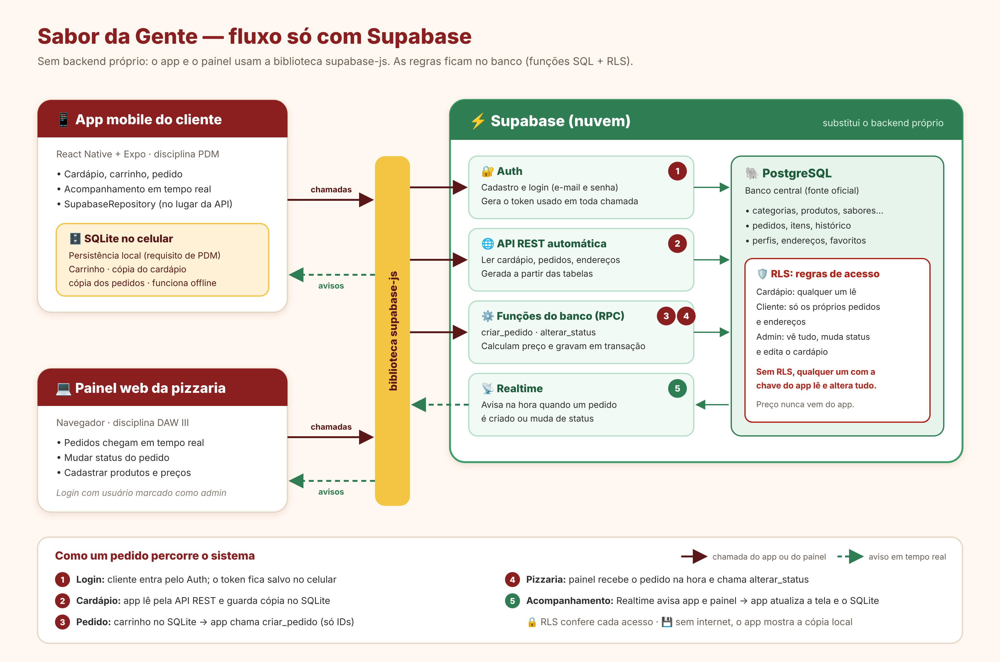

# 🍕 Sabor da Gente — banco de dados (Supabase)

Banco central do sistema Sabor da Gente, compartilhado por:

| Repositório | Usa o banco para |
|---|---|
| `mobile-sabor-da-gente` (PDM) | cardápio, pedidos, acompanhamento, perfil |
| painel web (DAW III) | pedidos, status, cardápio, clientes, estatísticas |

Não há backend próprio: o app e o painel falam direto com o **Supabase**
(PostgreSQL + Auth + API automática + Realtime). As regras de acesso ficam
no banco (**Row Level Security**) e as regras de negócio em **funções SQL**.



## Conteúdo

```
supabase/migrations/   SQL do banco, aplicado em ordem
  …_tabelas.sql           18 tabelas + gatilhos
  …_seguranca_rls.sql     permissões e regras de acesso (RLS)
  …_funcoes.sql           calcular_pedido, criar_pedido, alterar_status,
                          cancelar_pedido, estatisticas_vendas
  …_realtime.sql          avisos em tempo real de pedidos
  …_cardapio_inicial.sql  categorias, produtos, sabores, preços
docs/
  como-usar.md            guia para o app e o painel (supabase-js)
  modelo-de-dados.md      tabelas, regras de negócio e segurança
  fluxo-sistemas.png      diagrama do fluxo
testes/                   teste das regras num PostgreSQL local (opcional)
```

## Como montar o banco no Supabase

1. Crie um projeto em [supabase.com](https://supabase.com) (plano gratuito).
2. Aplique as migrations, de um destes jeitos:

   **a) Pelo painel (mais simples):** abra **SQL Editor** e rode o conteúdo de
   cada arquivo de `supabase/migrations/`, **um por vez e na ordem** do nome.

   **b) Pelo Supabase CLI:**
   ```bash
   npx supabase login
   npx supabase init            # só na primeira vez: cria supabase/config.toml
   npx supabase link --project-ref <id-do-projeto>
   npx supabase db push         # aplica as migrations que faltam
   ```
3. Crie o administrador (**Authentication → Users → Add user**) e, no SQL Editor:
   ```sql
   update public.perfis set tipo = 'admin'
    where id = (select id from auth.users where email = 'admin@sabordagente.com');
   ```
4. Copie a **URL do projeto** e a **publishable key** (Project Settings → API Keys)
   para o `.env` do app e do painel. Veja [`docs/como-usar.md`](docs/como-usar.md).

> ⚠️ Nunca use a *secret key* / *service_role* no app ou no painel: ela
> ignora todas as regras de segurança.

## Regras da equipe

- **Toda mudança no banco é uma nova migration** (`npx supabase migration new nome`).
  Não editem migrations já aplicadas e não mudem tabelas direto pelo painel
  sem registrar aqui — senão os bancos de cada um ficam diferentes.
- Toda tabela nova precisa de **RLS + permissões** (ver `…_seguranca_rls.sql`).
- O app nunca manda preço: pedidos só pelas funções `calcular_pedido` / `criar_pedido`.
- Mudou alguma tabela ou função usada pelos apps? Atualize `docs/como-usar.md`
  e avise nos repositórios do app e do painel.

## Testes (opcional)

Os testes rodam as migrations num PostgreSQL local que imita o Supabase e
conferem as regras como visitante, cliente e admin (59 verificações).

```bash
PGHOST=localhost PGUSER=postgres ./testes/recriar_banco.sh
pip install "psycopg[binary]"
TESTE_DSN="host=localhost user=postgres dbname=sabor_teste" python3 testes/testar_regras.py
```

## Plano gratuito do Supabase

- O projeto é **pausado após 7 dias sem uso** — reative pelo painel antes de apresentar.
- 500 MB de banco e 2 projetos por organização (de sobra para o projeto).
