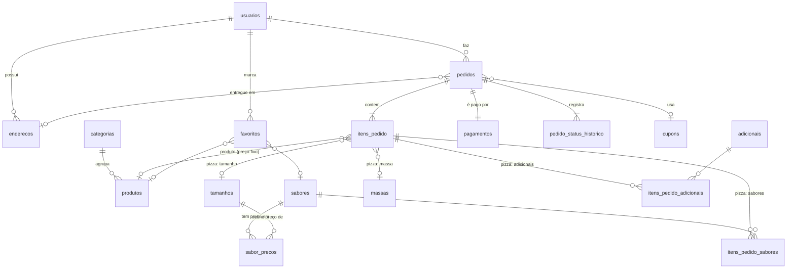

# Modelo de dados — Sabor da Gente

Banco único em **SQLite**, acessado **somente pela API** (`sabor-da-gente-api`).
O app mobile (PDM) e o painel web (DAW III) nunca abrem o arquivo do banco.

- Esquema: [`db/schema.sql`](../db/schema.sql)
- Dados iniciais: [`db/seed.sql`](../db/seed.sql)
- Contrato da API: [`api.md`](api.md)

## Convenções

| Assunto | Decisão | Por quê |
|---|---|---|
| Dinheiro | `INTEGER` em **centavos** (R$ 45,00 = `4500`) | Evita erro de arredondamento de `REAL` (0,1 + 0,2 ≠ 0,3). |
| Datas | `TEXT` ISO 8601 UTC (`2026-10-14T13:00:00Z`) | SQLite não tem tipo data; ISO ordena corretamente como texto. |
| Booleanos | `INTEGER` 0/1 | SQLite não tem `BOOLEAN`. |
| Exclusão | Catálogo usa `ativo = 0` (exclusão lógica) | Pedidos antigos continuam apontando para o produto. |
| Histórico | Pedidos guardam **snapshot** de nomes e preços | Mudar o preço da Calabresa amanhã não pode alterar o pedido de ontem. |
| Chaves estrangeiras | `PRAGMA foreign_keys = ON` em **toda** conexão | No SQLite elas vêm desligadas por padrão. |

## Diagrama ER



## Tabelas

### Pessoas
| Tabela | Papel |
|---|---|
| `usuarios` | Login de **clientes e administradores**. A coluna `tipo` (`cliente` / `admin`) diferencia os dois. |
| `enderecos` | Endereços do cliente (vários por cliente, um `principal`). |

### Catálogo
| Tabela | Papel |
|---|---|
| `categorias` | Pizzas, Esfihas, Bebidas, Combos, Sobremesas. `tipo = 'pizza'` faz o app abrir o "Monte sua pizza"; `tipo = 'produtos'` lista produtos. |
| `produtos` | Itens de **preço fixo**: esfihas, bebidas, sobremesas, combos. |
| `tamanhos` | Tamanhos de pizza, com `max_sabores` (Grande = 2). |
| `massas` | Tipos de massa, com `acrescimo` (pode ser 0). |
| `sabores` | Sabores de pizza (Calabresa, Portuguesa...). |
| `sabor_precos` | Preço de **cada sabor em cada tamanho**. Sem linha = indisponível naquele tamanho. |
| `adicionais` | Borda recheada, queijo extra etc. |
| `cupons` | *(fase 2)* Desconto percentual ou em valor fixo. |

### Pedido
| Tabela | Papel |
|---|---|
| `pedidos` | Cabeçalho: cliente, entrega/retirada, endereço (snapshot), status, valores. |
| `itens_pedido` | Cada linha. `tipo = 'produto'` aponta para `produtos`; `tipo = 'pizza'` aponta para `tamanhos` + `massas`. |
| `itens_pedido_sabores` | Sabores escolhidos na pizza, com nome e preço da época. |
| `itens_pedido_adicionais` | Adicionais da pizza, com nome e preço da época. |
| `pedido_status_historico` | Linha do tempo do acompanhamento (quem mudou e quando). |
| `pagamentos` | Pagamento **simulado** (1 por pedido): forma, status, troco. |

### Outros
| Tabela | Papel |
|---|---|
| `favoritos` | *(fase 2)* Cliente favorita um produto **ou** um sabor. |
| `configuracoes` | Chave/valor: `taxa_entrega`, `regra_preco_pizza`. |

## Por que pizza é diferente dos outros produtos

Uma esfiha tem um preço só. Uma pizza é **montada**: tamanho + massa + 1 ou 2 sabores + adicionais, e o preço depende da combinação. Se cada combinação fosse uma linha em `produtos`, seriam centenas de linhas. Por isso:

- produtos de preço fixo → `produtos`;
- pizza → peças (`tamanhos`, `massas`, `sabores`, `sabor_precos`, `adicionais`) que a API combina.

Isso também corrige o app atual, que guardava o nome da esfiha em `sabores`.

## Regras de negócio

### R1 — Preço da pizza
```
preco_unitario = preço_dos_sabores + massa.acrescimo + soma(adicionais.preco)
```
`preço_dos_sabores` segue `configuracoes.regra_preco_pizza`:
- **`maior`** (padrão, igual ao app hoje): o maior preço entre os sabores escolhidos, no tamanho escolhido.
  Grande Calabresa (45) + Portuguesa (48) → **R$ 48,00**.
- **`media`** (alternativa): média dos preços, arredondada para cima ao centavo.

> ⚠️ Decisão da equipe: confirmar qual regra vale. Basta mudar a configuração; o banco não muda.

### R2 — Quantidade de sabores
`1 ≤ nº de sabores ≤ tamanhos.max_sabores`, sem repetir sabor, e todos com preço cadastrado naquele tamanho.

### R3 — A API recalcula tudo
O app envia **IDs e quantidades**, nunca preços. A API busca os preços atuais, calcula e grava. Preço vindo do cliente é ignorado.

### R4 — Totais do pedido
```
item.subtotal  = preco_unitario × quantidade
pedido.subtotal = soma(item.subtotal)
pedido.desconto = cupom aplicado sobre o subtotal (nunca maior que o subtotal)
pedido.taxa_entrega = configuracoes.taxa_entrega se 'entrega', 0 se 'retirada'
pedido.total = subtotal − desconto + taxa_entrega
```
O banco reforça as duas igualdades com `CHECK`.

### R5 — Entrega
`tipo_entrega = 'entrega'` exige endereço **do próprio cliente** e ativo. A API copia o texto para `endereco_entrega` (snapshot).

### R6 — Pagamento simulado
Formas: `pix`, `cartao`, `dinheiro`. `troco_para` só em dinheiro e ≥ total. O pagamento nasce `pendente`; pix/cartão podem ser marcados `aprovado` na hora (simulação).

### R7 — Fluxo de status
```
realizado ──► em_preparacao ──► saiu_para_entrega ──► entregue      (entrega)
                       └──────► pronto_para_retirada ─► entregue    (retirada)
realizado / em_preparacao ──► cancelado
```
- Só o **admin** avança status.
- O **cliente** só pode cancelar enquanto o pedido está `realizado`.
- Toda mudança gera uma linha em `pedido_status_historico`.
- Transição fora do fluxo → erro `409 TRANSICAO_INVALIDA`.

### R8 — Cupom *(fase 2)*
Ativo, dentro da validade, `subtotal ≥ valor_minimo_pedido` e sem ultrapassar `usos_maximos` (contado em pedidos não cancelados).

### R9 — Gravação atômica
Pedido, itens, sabores, adicionais, pagamento e primeiro status são gravados numa **única transação**. Se algo falhar, nada é salvo.

## Mapeamento para POO (classes no backend)

| Classe | Tabela(s) | Observação |
|---|---|---|
| `Usuario` (abstrata) | `usuarios` | |
| `Cliente extends Usuario` | `usuarios` (`tipo='cliente'`) | tem `enderecos`, `pedidos`, `favoritos` |
| `Administrador extends Usuario` | `usuarios` (`tipo='admin'`) | `alterarStatus(pedido, status)` |
| `Categoria` | `categorias` | |
| `Produto` | `produtos` | `preco` fixo |
| `Pizza` | `tamanhos`, `massas`, `sabores`, `adicionais` | `calcularPreco()` implementa R1/R2 |
| `Sabor`, `Tamanho`, `Massa`, `Adicional` | idem | |
| `ItemPedido` (abstrata) | `itens_pedido` | `subtotal()` |
| `ItemProduto extends ItemPedido` | `tipo='produto'` | |
| `ItemPizza extends ItemPedido` | `tipo='pizza'` + sabores/adicionais | |
| `Pedido` | `pedidos` | `calcularTotais()`, `alterarStatus()` (R4, R7) |
| `Endereco` | `enderecos` | |
| `Pagamento` | `pagamentos` | |
| `Cupom` | `cupons` | `calcularDesconto(subtotal)` |

Herança em tabela única (`usuarios` com `tipo`) e polimorfismo em `ItemPedido` são bons exemplos de POO para apresentar.

## Fases

| Fase 1 (essencial) | Fase 2 (se der tempo) |
|---|---|
| usuários, endereços, categorias, produtos, tamanhos, massas, sabores, adicionais, pedidos, itens, pagamentos, histórico de status | cupons, favoritos, estatísticas avançadas, imagens por upload |

As tabelas da fase 2 já estão no esquema; basta não expor as rotas até lá.
