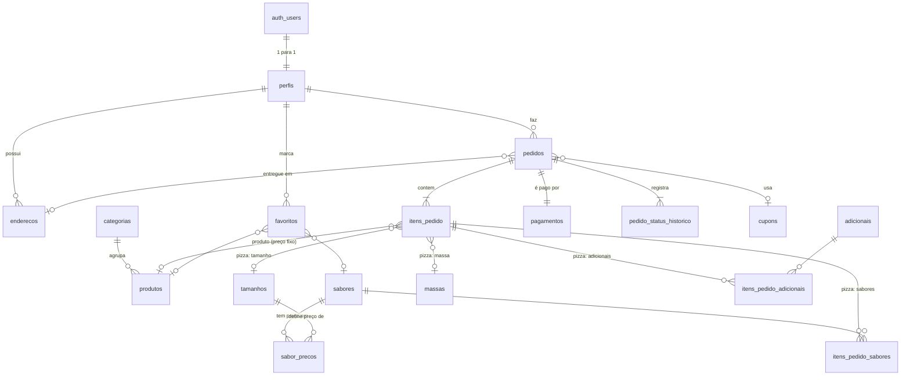

# Modelo de dados — Sabor da Gente

Banco único em **PostgreSQL no Supabase**. O app mobile (PDM) e o painel web
(DAW III) acessam pela biblioteca supabase-js; as regras de acesso ficam no
próprio banco (Row Level Security) e as regras de negócio em funções SQL.

- SQL: [`../supabase/migrations/`](../supabase/migrations/)
- Como usar no app e no painel: [`como-usar.md`](como-usar.md)
- Fluxo entre os sistemas: [`fluxo-sistemas.png`](fluxo-sistemas.png)
- Modelo lógico (brModelo): [`sabor-da-gente-modelo-logico.png`](sabor-da-gente-modelo-logico.png)
  — feito na versão SQLite; as tabelas são as mesmas, exceto `usuarios`, que virou `perfis` (ver abaixo).

O app mobile também tem um **SQLite local** com uma cópia reduzida deste
modelo (mesmos nomes de tabelas e colunas), para a persistência local exigida
em PDM e para funcionar sem internet.

## Convenções

| Assunto | Decisão | Por quê |
|---|---|---|
| Dinheiro | `integer` em **centavos** (R$ 45,00 = `4500`) | Evita erro de arredondamento. |
| Datas | `timestamptz` | Fuso horário correto. |
| Exclusão | Catálogo usa `ativo = false` | Pedidos antigos continuam apontando para o produto. |
| Histórico | Pedidos guardam **fotografia** de nomes e preços | Mudar o preço amanhã não altera o pedido de ontem. |
| Usuários | Login e senha no **Supabase Auth** (`auth.users`); dados em `perfis` | Senha nunca fica numa tabela nossa. |
| Segurança | **RLS ligado em todas as tabelas** + permissões explícitas | O app usa uma chave pública. |

## Diagrama ER



## Tabelas

### Pessoas
| Tabela | Papel |
|---|---|
| `auth.users` | *(do Supabase)* e-mail e senha. Não é acessada pelo app. |
| `perfis` | Nome, telefone e `tipo` (`cliente` / `admin`). Criado sozinho no cadastro. |
| `enderecos` | Endereços do cliente (vários, um `principal`). |

### Catálogo
| Tabela | Papel |
|---|---|
| `categorias` | Pizzas, Esfihas, Bebidas, Combos, Sobremesas. `tipo = 'pizza'` abre o "Monte sua pizza". |
| `produtos` | Itens de **preço fixo**: esfihas, bebidas, sobremesas, combos. |
| `tamanhos` | Tamanhos de pizza, com `max_sabores`. |
| `massas` | Tipos de massa, com `acrescimo`. |
| `sabores` | Sabores de pizza. |
| `sabor_precos` | Preço de **cada sabor em cada tamanho**. Sem linha = indisponível. |
| `adicionais` | Borda recheada, queijo extra etc. |
| `cupons` | *(fase 2)* Desconto percentual ou em valor fixo. |
| `configuracoes` | `taxa_entrega`, `regra_preco_pizza`. |

### Pedido
| Tabela | Papel |
|---|---|
| `pedidos` | Cabeçalho: cliente, entrega/retirada, endereço (fotografia), status, valores. |
| `itens_pedido` | Cada linha: `produto` (aponta para `produtos`) ou `pizza` (aponta para `tamanhos` + `massas`). |
| `itens_pedido_sabores` | Sabores da pizza, com nome e preço da época. |
| `itens_pedido_adicionais` | Adicionais da pizza, com nome e preço da época. |
| `pedido_status_historico` | Linha do tempo do acompanhamento (quem mudou e quando). |
| `pagamentos` | Pagamento **simulado** (1 por pedido). |
| `favoritos` | *(fase 2)* Produto **ou** sabor favorito. |

## Por que pizza é diferente dos outros produtos

Uma esfiha tem um preço só. Uma pizza é **montada** (tamanho + massa + 1 ou 2
sabores + adicionais) e o preço depende da combinação. Por isso pizza não é
uma linha em `produtos`: o banco combina as peças na hora do pedido.

## Regras de negócio — onde cada uma está

| # | Regra | Onde |
|---|---|---|
| R1 | Preço da pizza = preço dos sabores (**maior** ou **média**, conforme `configuracoes.regra_preco_pizza`) + `massa.acrescimo` + soma dos adicionais | função `calcular_itens` |
| R2 | 1 ≤ sabores ≤ `tamanhos.max_sabores`, sem repetir, todos com preço no tamanho | função `calcular_itens` |
| R3 | O app manda **IDs e quantidades**, nunca preços | funções `calcular_pedido` / `criar_pedido` |
| R4 | `subtotal = Σ itens`; `total = subtotal − desconto + taxa_entrega`; taxa só em entrega | função `calcular_totais` + `CHECK` na tabela |
| R5 | Entrega exige endereço **do próprio cliente**; o texto é copiado para o pedido | função `criar_pedido` |
| R6 | Pagamento simulado: pix/cartão aprovados na hora, dinheiro pendente; troco só em dinheiro e ≥ total | função `criar_pedido` + `CHECK` |
| R7 | Fluxo de status (abaixo); só admin avança; cliente só cancela em "realizado" | funções `alterar_status` / `cancelar_pedido` |
| R8 | Cupom: ativo, na validade, subtotal ≥ mínimo, dentro do limite de usos; desconto ≤ subtotal | função `calcular_totais` |
| R9 | Pedido, itens, sabores, adicionais, pagamento e 1º status gravados juntos | função `criar_pedido` (uma transação) |

### Fluxo de status (R7)
```
realizado ──► em_preparacao ──► saiu_para_entrega ──► entregue      (entrega)
                       └──────► pronto_para_retirada ─► entregue    (retirada)
realizado / em_preparacao ──► cancelado
```

## Segurança (RLS)

| Quem | Pode |
|---|---|
| Visitante (`anon`) | ler o cardápio ativo |
| Cliente | o próprio perfil (só nome e telefone), os próprios endereços, favoritos e pedidos; criar e cancelar pedidos pelas funções |
| Admin (`perfis.tipo = 'admin'`) | tudo do cardápio, todos os pedidos, mudar status, aprovar pagamento, estatísticas |

Ninguém grava em `pedidos`, `itens_pedido`, `pagamentos` ou no histórico
diretamente: só pelas funções, que validam antes. Detalhes em
[`como-usar.md`](como-usar.md#8-resumo-do-que-cada-um-pode-fazer).

## POO no app mobile

As classes de domínio ficam no app (`src/models/` e `src/repositories/`):

| Classe | Corresponde a |
|---|---|
| `Categoria`, `Produto`, `Tamanho`, `Massa`, `Sabor`, `Adicional` | tabelas do catálogo |
| `CardapioRepository` (interface) | acesso ao cardápio |
| `SqliteCardapioRepository` | cópia local no celular |
| `SupabaseCardapioRepository` *(integração)* | este banco |

O mesmo padrão vale para pedidos e perfil: uma interface, duas implementações
(SQLite local e Supabase), e as telas não sabem de onde vêm os dados.

## Fases

| Fase 1 (essencial) | Fase 2 (se der tempo) |
|---|---|
| perfis, endereços, catálogo, pedidos, itens, pagamentos, histórico, Realtime | cupons, favoritos, estatísticas avançadas, imagens no Supabase Storage |

As tabelas e regras da fase 2 já estão no banco; basta não usar até lá.
